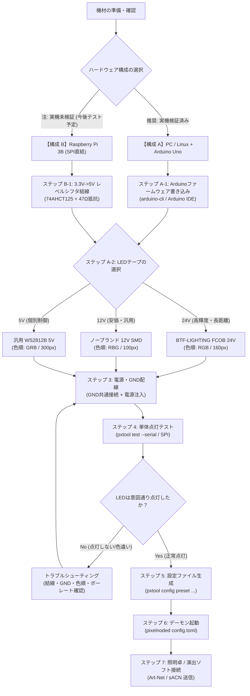

# PixelNode フローチャート式セットアップガイド

> [!IMPORTANT]
> **実機テスト・検証ステータス（2026年10月現在の事実）**
> - **Arduino Uno (USB-Serial) + LEDテープ（Pin D6）**: **実機接続テスト完了・点灯確認済み**  
>   CH340 / ATmega16U2 経由での 115200bps 通信、双方向テレメトリ、自律パターン点灯を実機で確認しています。
> - **Raspberry Pi 3B (SPI0 MOSI / GPIO10)**: **実機テスト未完了（未検証・今後テスト予定）**  
>   現時点ではコード上のドライバ実装およびシミュレータテストのみであり、Raspberry Pi 実機での物理点灯確認はまだ行われていません。

---

## 1. セットアップ全体フローチャート

お使いになるハードウェア構成（PC + Arduino Uno または Raspberry Pi）と、LEDテープの種類に応じて、以下のフローに従ってセットアップを行ってください。



---

## 2. 各ステップの詳細手順

### ステップ A: Arduino Uno 構成（実機テスト完了済み・推奨）

Linux PC や Raspberry Pi の USB ポートに Arduino Uno を接続し、LED制御信号の生成を Arduino にオフロードする構成です。

#### 1. ファームウェアの書き込み
Arduino CLI または Arduino IDE を使用して、最新ファームウェアを書き込みます：

```bash
# arduino-cli を使用する場合 (/dev/ttyUSB0 の例)
arduino-cli compile --fqbn arduino:avr:uno firmware/pixelnode_uno
arduino-cli upload -p /dev/ttyUSB0 --fqbn arduino:avr:uno firmware/pixelnode_uno
```

> **通電・導通チェック機能**:  
> Arduino のリセット直後、Pin D6 に接続された LED の先頭 5 球が **赤 → 緑 → 青 → 橙（アンバー）** の順に各 100ms 点滅します。PC と通信する前でも、LEDテープの電源・GND・信号線の導通を視覚的に確認できます。

---

### ステップ B: Raspberry Pi SPI 構成（※実機未検証・今後テスト予定）

Raspberry Pi の 40pin GPIO から直接 SPI 信号を出力する構成です。**現時点では実機での物理点灯テストが行われていないため、今後実機検証を予定しています。**

1. **レベルシフタ（74AHCT125 等）の接続**:
   Raspberry Pi の GPIO は 3.3V 出力のため、5V/12V/24V WS2811 の推奨入力電圧（約3.5V以上）を満たせません。74AHCT125 などの高速 CMOS IC を介して 5V に昇圧し、信号線に 33〜100Ω のダンピング抵抗を直列に入れます。
2. **ピン配置**:
   - **GPIO10 (SPI0 MOSI)**: 物理 19 番ピン $\rightarrow$ レベルシフタ入力
   - **GND**: 物理 20 番ピン $\rightarrow$ LED 電源 GND と共通接続

---

### ステップ 3: LEDテープの配線・電源注入・色順

使用するテープの仕様に合わせて結線します。**信号線のノイズや誤動作を防ぐため、コントローラー（Arduino/Pi）の GND と LED 電源の GND は必ず直接結線して共通化してください。**

| プリセット名 | 対象テープ | 電圧 | 色順 | 10m/5mあたりのピクセル数 | 電源注入の目安 |
|---|---|:---:|:---:|:---:|---|
| **`btf_fcob_576_24v_10m`** | BTF-LIGHTING FCOB | **24V** | **RGB** | 160 px (36球/IC) | 両端（0m / 10m）からの給電必須 |
| **`nobrand_60led_12v_5m`** | ノーブランド 5050 SMD | **12V** | **RBG** | 100 px (3球/IC) | 両端（0m / 5m）からの給電必須 |
| **`ws2812b_60led_5v_5m`** | 汎用 WS2812B | **5V** | **GRB** | 300 px (1球/IC) | 両端＋2mおきの中間注入必須 |

> [!NOTE]
> **色順（カラーオーダー）の重要性**:  
> 12V のノーブランドテープは、基板配線の都合で緑と青が逆転した **`RBG`** になっている個体が多く存在します。赤を指定したのに緑が光る場合は、色順設定を確認してください。

---

### ステップ 4: 単体点灯テスト（照明卓なしでの点検）

照明卓やネットワークを繋ぐ前に、`pxtool test` コマンドでハードウェアが正常に制御できるかを直接点灯させて点検します。

```bash
# 【Arduino Uno 接続の場合】
# 1. 赤色で 3 秒間点灯（60ピクセル、GRBテープ）
./target/debug/pxtool test --serial /dev/ttyUSB0 --pixels 60 --color-order grb --mode color --color "255,0,0" --duration 3

# 2. 多重センターリップル（Slot 24）をシアン色で 5 秒間点灯
./target/debug/pxtool test --serial /dev/ttyUSB0 --pixels 60 --color-order grb --pattern 24 --color "0,220,255" --duration 5

# 3. 4つの新パターン（多重リップル・2色ウェーブ・一方向パルス・外側集約）を一括テスト
./tests/test_new_patterns.sh /dev/ttyUSB0 60 grb 115200
```

正常に通信できると、ターミナルに以下のようなマイコン側受信ステータスが表示されます：
```
Connected to Arduino Uno on '/dev/ttyUSB0' (baud: 115200)
Synchronized MCU configuration: 60 pixels (order: grb)
[MCU Status] Rx: 80 frames, CRC err: 0, Pixels: 60, Failsafe: false
```

---

### ステップ 5 & 6: 設定ファイル生成とデーモン起動

単体テストで正常点灯を確認したら、本番用の設定ファイル（TOML）を生成して `pixelnoded` を起動します。

```bash
# プリセットから設定ファイルを生成 (BTF-LIGHTING 24V テープ、Arduino Uno 出力)
./target/debug/pxtool config preset btf_fcob_576_24v_10m \
    --output-driver serial_mcu \
    --device /dev/ttyUSB0 \
    --universe 1 \
    --personality standard \
    > node_config.toml

# 設定ファイルを指定してデーモンを起動
RUST_LOG=info ./target/debug/pixelnoded --config node_config.toml
```

---

### ステップ 7: 照明卓 / 演出ソフトからの送出

デーモンが起動したら、ネットワーク上の照明コンソール（grandMA3, ChamSys, Avolites, QLC+, TouchDesigner 等）から Art-Net または sACN を Universe 1 宛てに送信します。

- **Standard 12ch モードのチャンネル構成**:
  - `Ch 1`: Master Dimmer (0〜255)
  - `Ch 2〜4`: RGB Base Color
  - `Ch 5`: White (0)
  - `Ch 6`: Pattern Slot (0=静止, 192=多重リップル, 200=2色ウェーブ, 208=一方向パルス, 216=外側集約)
  - `Ch 7`: Audio Sync (0=自律パターンに従う)
  - `Ch 8`: Speed (128=等倍正方向, 192=等倍逆方向)
  - `Ch 9`: Size (128=標準幅/標準波長)
  - `Ch 10〜12`: Fade / Strobe / Special
